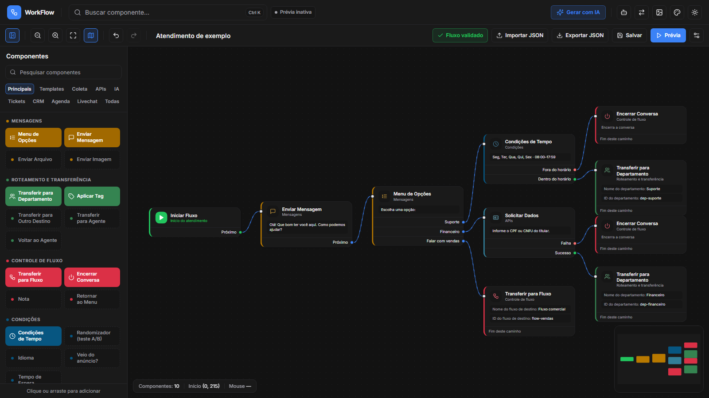
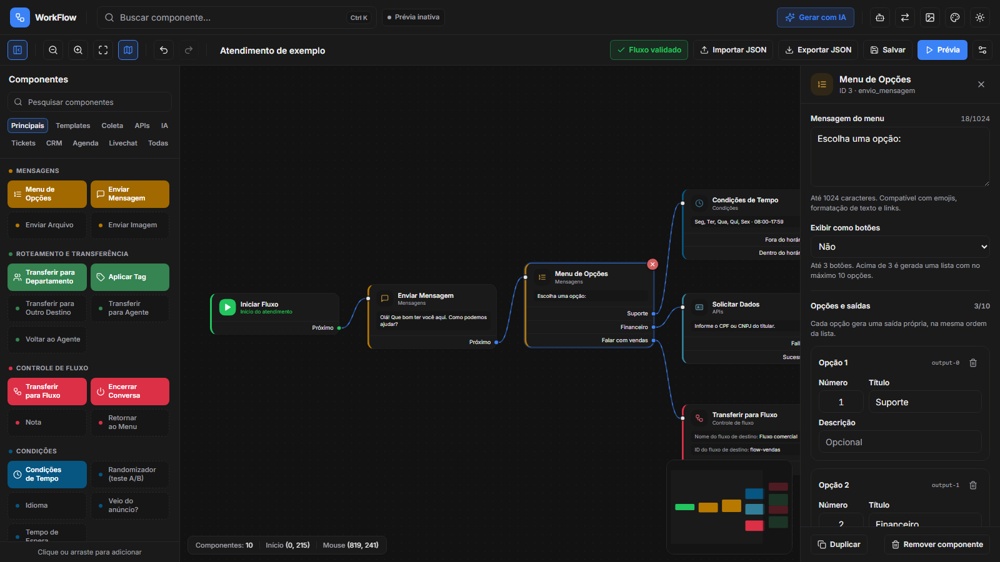
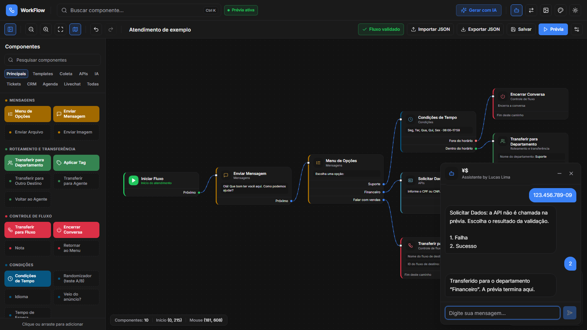
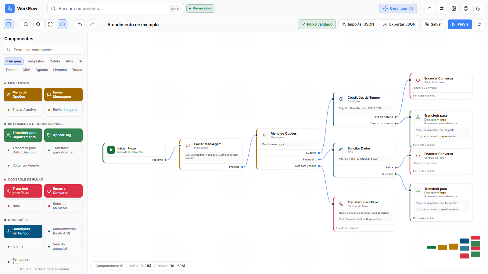

<div align="center">


# WorkFlow

### Um editor visual de fluxos de atendimento que exporta direto no JSON da plataforma.

[](https://nextjs.org/)
[](https://react.dev/)
[](https://www.typescriptlang.org/)
[](https://tailwindcss.com/)
[](https://flow-yzy.vercel.app/flow)
[](https://discord.com/invite/3XRFGeqEYD)

[](https://github.com/opZywl/flow/actions/workflows/ci.yml)
[](https://github.com/opZywl/flow/actions/workflows/codeql.yml)

[opZywl](https://github.com/opZywl) · [flow-yzy.vercel.app](https://flow-yzy.vercel.app/flow) · [lucas-lima.xyz](https://lucas-lima.xyz) · [LinkedIn](https://www.linkedin.com/in/lucsp-lima/)

[English](README.md) · **Português**

</div>

## O que faz

Você desenha a conversa: arrasta componentes para o canvas, liga as saídas e
preenche cada etapa num painel lateral. O editor confere o fluxo enquanto você
trabalha e exporta um JSON que a plataforma de Atendimento importa sem ajuste.

É ida e volta de verdade. Importe um arquivo exportado pela plataforma,
exporte de novo e o arquivo volta igual, byte a byte, só com a data de
exportação atualizada. Tudo o que você cria segue a mesma estrutura, os mesmos
IDs e o mesmo padrão de conexões.

## Capturas

<table>
  <tr>
    <td></td>
    <td></td>
  </tr>
  <tr>
    <td></td>
    <td></td>
  </tr>
</table>

## O editor

| Na tela | O que faz |
|---|---|
| biblioteca | os 61 componentes da paleta por categoria, com busca; clique ou arraste para adicionar |
| canvas | conexões com regras (uma entrada por componente, um destino por saída), seleção múltipla, desfazer e refazer, minimapa |
| componentes | resumo de cada etapa, saídas com nome e botão de remover ao passar o mouse |
| painel | campos de cada componente na ordem da plataforma, com editores para opções do menu, horários, caminhos com peso, condições e listas, além dos campos técnicos e do JSON completo |
| validação | pendências ao vivo, mostradas também abaixo do campo a que se referem; cada uma leva ao componente que precisa de atenção |
| prévia | conversa simulada com os 62 componentes, em que você escolhe o resultado de cada integração, sem chamar a plataforma |
| importação | JSON de Atendimento, fluxos antigos deste editor e geração por IA |
| tema | claro ou escuro, com a cor de destaque escolhida em Cores |

`Ctrl+Z` desfaz, `Ctrl+Y` refaz, `Ctrl+S` salva, `Ctrl+K` busca no fluxo e
`Delete` remove a seleção. Soltar um `.json` no canvas importa o arquivo.

## Compatibilidade com o JSON de Atendimento

O formato vem de arquivos exportados pela própria plataforma, e esses arquivos
são a única fonte que o editor segue:

- envelope com `name`, `description`, `service_type`, `created_at`, `nodes`, `edges` e `viewport`
- componentes com `data.type`, `data.data` e `data.html`, gravados como `type: "custom"`, exceto a Nota (`"note"`) e o Menu de Opções API (`"apiOptionsMenu"`), exatamente como a plataforma grava; o início é sempre `inicio` e os demais recebem IDs numéricos sequenciais
- conexões `deletable` com `sourceHandle: "output-N"` e id `xy-edge__<origem><saída>-<destino>`
- `created_at` gravado na exportação, com a mesma serialização da plataforma

Os 62 componentes da plataforma têm exemplo real nesses exports, e o editor
cria cada um exatamente com os mesmos campos, ordem das chaves, valores padrão,
html e tamanho: 4 de mensagens, 4 de templates, 5 de roteamento e
transferência, 7 de agendamentos, 3 de tickets, 7 de CRM, 1 de livechat, 5 de
controle de fluxo, 5 de condições, 2 de IA, 14 de APIs e 5 de coleta de dados.
A biblioteca mostra 61 deles; o 62º é o início, que todo fluxo já tem.

A maioria dos componentes tem uma única saída (Próximo) ou nenhuma, quando
encerra aquele caminho. Os que têm mais de uma saída estão abaixo; os
componentes mais antigos da plataforma põem o caminho negativo em `output-0`, e
os mais novos põem ali o positivo.

<details>
<summary>Componentes com mais de uma saída</summary>

| Componente | Saídas, na ordem |
|---|---|
| Menu de Opções | uma por opção, seguindo `text-1`, `text-2`… (até 10) |
| Múltipla Condição | uma por condição, seguindo `var-1`, `var-2`… (até 20) |
| Randomizador (teste A/B) | uma por caminho com peso, no mínimo 2 |
| Agente de IA | uma por saída do agente, e depois Sem conclusão |
| Idioma | Português, Inglês, Espanhol, Outro idioma |
| Condições de Tempo | Fora do horário, Dentro do horário |
| Solicitar Dados, Consulta API, API de Mensagem, DataStore Local, Enviar Boletos | Falha, Sucesso |
| Condicional | Falso, Verdadeiro |
| Enviar Formulário | Respondido, Não respondido |
| Transferir para Ligação, Continuar no Chat | Sucesso, Falha |
| Escolher Serviço | Serviço escolhido, Nenhum disponível |
| Escolher Local | Local escolhido, Nenhum disponível |
| Escolher Profissional | Profissional escolhido, Nenhum disponível |
| Escolher Horário | Horário escolhido, Nenhum disponível |
| Identificar Cliente (agendamentos e CRM) | Identificado, Não identificado |
| Dados do Cliente | Dados registrados, Dados não registrados |
| Confirmar Agendamento | Agendado, Não agendado |
| Consultar Chamados | Chamado escolhido, Nenhum chamado |
| Abrir Chamado | Chamado aberto, Não aberto |
| Detalhe do Chamado | Encontrado, Não encontrado |
| Criar/Atualizar Contato, Capturar Lead, Qualificar Lead, Agendar Follow-up, Inscrever em Lista | Sucesso, Falha |
| Google Planilhas, Registrar no RD Station, Criar/Atualizar no HubSpot, Menu de Opções API | Sucesso, Falha |
| Entrada de Dados | Válido, Inválido |
| Veio do anúncio? | Sim, Não |
| Consentimento | Aceitou, Recusou |

</details>

A validação só bloqueia a exportação por erros de fato, como estrutura
quebrada, saídas sem conexão ou valores inválidos. Componente ainda não
configurado gera aviso, então um export da plataforma com etapas pela metade
continua indo e voltando sem alteração. A lista completa de componentes, o
significado das saídas e as regras estão em
[docs/atendimento-compatibilidade.md](docs/atendimento-compatibilidade.md).

## Rodando você mesmo

O WorkFlow é um app Next.js. Precisa do Node 20.9 ou mais novo e do pnpm 10.

```sh
git clone https://github.com/opZywl/flow
cd flow
pnpm install
pnpm dev     # editor em http://localhost:3000/flow
pnpm build   # build de produção
pnpm start   # serve o build na porta 3000
```

A geração por IA usa a sua própria chave de API, digitada no diálogo. A chave
vai só junto com a requisição e não fica guardada no servidor.

## Comandos

| Comando | O que faz |
|---|---|
| `pnpm dev` | servidor de desenvolvimento na porta 3000 |
| `pnpm build` e `pnpm start` | build e servidor de produção |
| `pnpm typecheck` | checagem de tipos |
| `pnpm lint` | ESLint |
| `pnpm test` | testes unitários do formato e da prévia |
| `pnpm check:reference -- "<arquivo>"` | confere a ida e volta de um JSON exportado pela plataforma |
| `pnpm test:e2e` | build de produção e testes de navegador com Playwright |

Aponte `FLOW_REFERENCE` para um ou mais JSON exportados pela plataforma e os
testes unitários e de navegador também validam esses arquivos. Separe os
arquivos com o delimitador de caminhos do sistema, `:` no Linux e no macOS e
`;` no Windows:

```sh
FLOW_REFERENCE="caminho/export-1.json:caminho/export-2.json" pnpm test
FLOW_REFERENCE="caminho/export-1.json:caminho/export-2.json" pnpm test:e2e
```

```powershell
$env:FLOW_REFERENCE = "caminho\export-1.json;caminho\export-2.json"
pnpm test
pnpm test:e2e
```

Cada arquivo vira um teste próprio: ida e volta byte a byte sem erro de
validação, todo tipo de componente conhecido, prévia respondendo a todas as
escolhas alcançáveis e a mesma ida e volta pelo navegador. Sem a variável,
esses testes são ignorados com aviso, assim como um arquivo que não existe.
Mantenha exports reais fora do repositório: eles têm dados internos.

## O que tem aqui

```text
app/                rotas do Next.js e a API de geração por IA
src/flow/           o editor: canvas, componentes, biblioteca, painel e prévia
lib/atendimento/    o formato: importação, validação, exportação e simulação
components/ui/      componentes base da interface
tests/              testes unitários e de navegador
docs/               compatibilidade com o JSON de Atendimento
scripts/            verificações de arquivos exportados
.github/            CI, CodeQL, revisão de dependências e Dependabot
```

Cada push roda checagem de tipos, lint, testes unitários, build de produção e
testes de navegador, além da análise do CodeQL. A produção sobe na Vercel a
partir do `main`.

## Autor

O WorkFlow é criado e mantido por **Zywl** ([GitHub](https://github.com/opZywl) · [lucas-lima.xyz](https://lucas-lima.xyz)).

## Problemas

Achou um bug ou sentiu falta de algo? Me avise abrindo uma
[issue](https://github.com/opZywl/flow/issues). Nunca anexe um export real com
dados de clientes, tokens ou URLs internas; falhas de segurança vão por um
[aviso privado](https://github.com/opZywl/flow/security/advisories/new).

## Licença

Copyright (C) 2026 Zywl.

Este projeto está sob a [GNU General Public License v3.0](LICENSE). A licença
cobre o código-fonte deste repositório. As dependências mantêm as próprias
licenças.

Para quem não conhece a licença, segue um resumo dos pontos principais. Isto
não é aconselhamento jurídico nem tem valor legal.

Você pode

- usar
- compartilhar
- modificar

este projeto, inteiro ou em parte, de graça e até comercialmente. Mas atenção:

- **Você precisa divulgar o código-fonte do seu trabalho modificado e o código que tirou deste projeto. Ou seja, não pode usar código daqui (nem em parte) num aplicativo de código fechado ou ofuscado.**
- **O seu aplicativo modificado também precisa ser licenciado sob a GPL.**

Faça isso e compartilhe o seu código com todo mundo, como este projeto faz.

## Ícones

Os ícones são do [Lucide](https://lucide.dev).

## Contribuindo

Contribuições são bem-vindas. Faça um fork, aplique a mudança e abra um pull
request; o modelo lista as verificações a rodar antes de enviar.

## Commits

`tipo: (escopo) assunto`, em minúsculas, sem ponto final.

`feat` `fix` `refactor` `chore` `docs` `test`

Acrescente um corpo curto quando só o assunto deixar o próximo leitor em dúvida.
